  <a href="https://x.com/0x_TIMii">
    <picture>
      <source media="(max-width: 600px)" srcset="assets/hero-mobile.svg">
      
    </picture>
  </a>

  <picture>
    <source media="(max-width: 600px)" srcset="assets/about-mobile.svg">
    
  </picture>

  <picture>
    <source media="(max-width: 600px)" srcset="assets/building-mobile.svg">
    
  </picture>
   
  <a href="https://arclis.world">arclis.world</a>

  <picture>
    <source media="(max-width: 600px)" srcset="assets/shipped-mobile.svg">
    
  </picture>
   
  
    <a href="https://github.com/Timioni001/Gallery-Arcana">Gallery Arcana</a> ·
    <a href="https://arcway.world">Arcway</a> ·
    <a href="https://github.com/Timioni001/modalis">Modalis</a> ·
    <a href="https://github.com/Timioni001/chog-arena">Chog Arena</a> ·
    <a href="https://github.com/Timioni001/Rook">Rook</a>
  

  <picture>
    <source media="(max-width: 600px)" srcset="assets/stack-mobile.svg">
    
  </picture>

  <picture>
    <source media="(max-width: 600px)" srcset="assets/contrib-mobile.svg">
    
  </picture>
   
  

  <a href="https://x.com/0x_TIMii">
    <picture>
      <source media="(max-width: 600px)" srcset="assets/footer-mobile.svg">
      
    </picture>
  </a>

